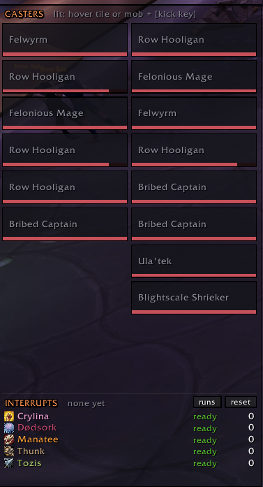

# MPlusKick

**A Mythic+ interrupt helper built for Midnight's addon rules.** See who is casting, kick it with one key, and see after the run who kicked what.

Midnight blocks addons from choosing targets or reading enemy casts in dungeons. MPlusKick doesn't try to get around that. It shows you what's happening using the display methods Blizzard allows, and leaves the kick to you, on one key.

---

## Features

### One-key kick
- Bind one key to your interrupt. It kicks your **focus**, else the mob under your **mouse**, else your **target**.
- Detects your class and spec interrupt automatically. Warlocks get Spell Lock or Axe Toss through Command Demon, following the active demon.
- **Shift-click** the kick button, or press the focus key, to focus the mob under your mouse.

### Casting panel
- One tile per enemy nameplate. A tile **lights up when that mob starts an interruptible cast**, with spell, cast bar, health bar and raid marker.
- **Hover a lit tile and press your kick key** to kick that mob. You don't need to find it on screen.
- Uninterruptible casts never light up, and lit tiles go dark while your kick is on cooldown. Tiles fade when the mob is out of your kick range.
- Move and resize it freely: columns, tile count and tile size. Shown only in dungeons by default.

### Alerts
- Center-screen cards for current casts (up to 6, resizable).
- A pulsing **KICK** tag above casting nameplates.
- A **PRIORITY** toast when you mouse over a mob on the must-kick list.

### Must-kick list for Midnight Season 2
- Covers every dungeon in the pool: Altar of Fangs, Murder Row, Den of Nalorakk, The Blinding Vale, Voidscar Arena, Kings' Rest, Temple of Sethraliss and Ruby Life Pools.
- Add your own mobs in game with `/mk add <note>`. Right-click any interrupted spell to mark it important or not.

### Interrupt tracker
- Counts per player, **synced from Blizzard's own damage meter** after every pull (the same data Details! uses). Pet kicks count for their owner.
- **Click a player** to see which enemy spells they stopped and on which mob. Priority spells are highlighted.
- **Party kick cooldowns:** each player's interrupt and whether it's ready.
- **Run recap** when a key ends (landed, pressed, missed, important). The last 10 runs are kept.

---

## Getting started
1. Esc > Options > Keybindings > AddOns > **MPlusKick**: bind "Interrupt".
2. Type `/mk` for options, or `/mk unlock` to move and resize everything.
3. In a key: when a tile lights up, hover it and press your kick key.

## Commands
| Command | What it does |
|---|---|
| `/mk` | Options window |
| `/mk unlock` / `/mk lock` | Move and resize frames |
| `/mk test` | Preview the alerts |
| `/mk add <note>` | Add your target to the must-kick list |
| `/mk important [spell]` | List or toggle your important spells |
| `/mk kicks [reset]` | Interrupt counts this run |
| `/mk runs` / `/mk recap` | Run history / current run recap |
| `/mk reset` | Reset frame positions |
| `/mk debug` | Load errors and diagnostics |

## Midnight limitations (by Blizzard's design)
- **No click-to-kick on tiles or nameplates.** Addon buttons can't act on enemy nameplates. Hovering a tile and pressing your key works, because the game itself picks the mouseover target.
- **No automatic kick assignments or rotations.** Blizzard bans them, and other players' casts and addon messages are hidden during keys.
- **Hidden values are displayed, not read.** Spell names, health and the interruptible state are shown, but can't be filtered on inside keys.
- **Party cooldowns are best-effort inside keys.** They're inferred from timing (marked `~`), and a party member's missed kick can't be seen.

## Feedback
Found a bug? Type `/mk debug` and include its output in your report.

## Development
- The repository root is the addon. Link or copy it into `World of Warcraft\_retail_\Interface\AddOns\MPlusKick`.
- Releases are automatic: every push to `main` that touches the addon bumps the version, tags it, and publishes to CurseForge and GitHub Releases. The default bump is patch. Put `#minor` or `#major` in the commit message for a bigger bump, or `[skip release]` to push without releasing.
- Tests run outside the game against a stubbed WoW API: `lua tests/run.lua` (Lua 5.1+). It prints `ALL OK` when everything passes.
- License: MIT.
